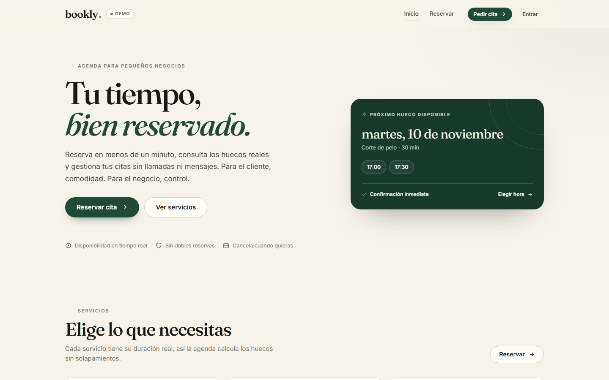
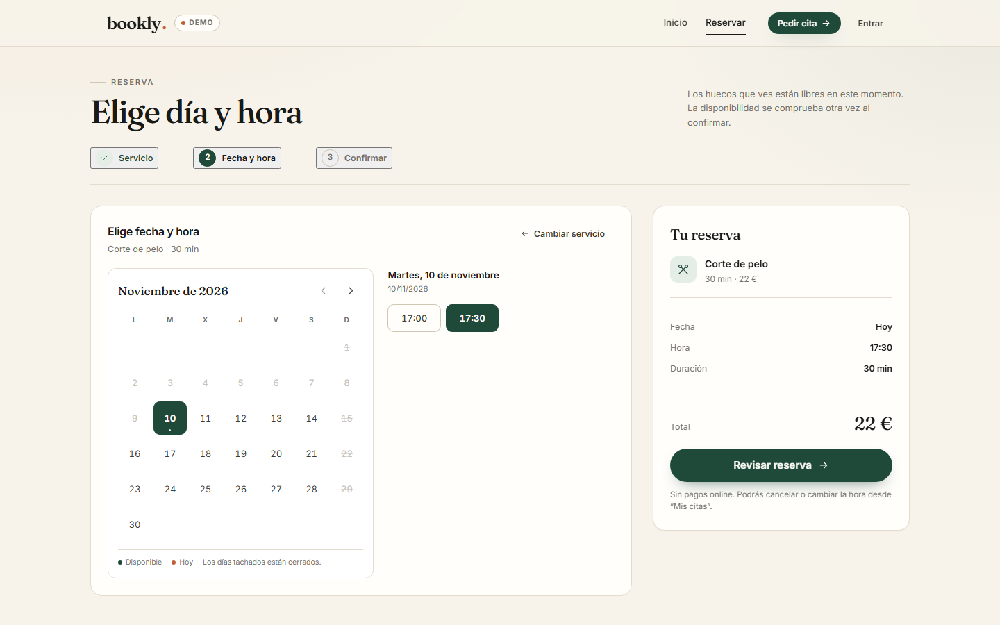
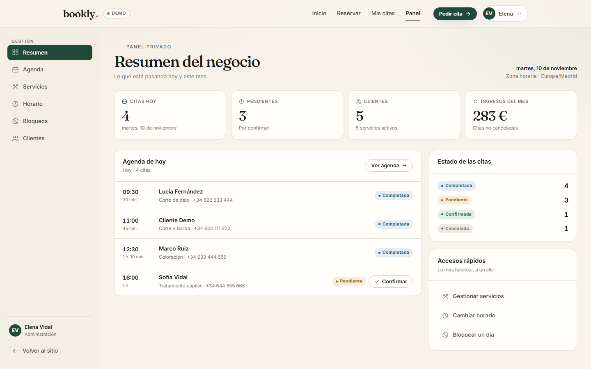
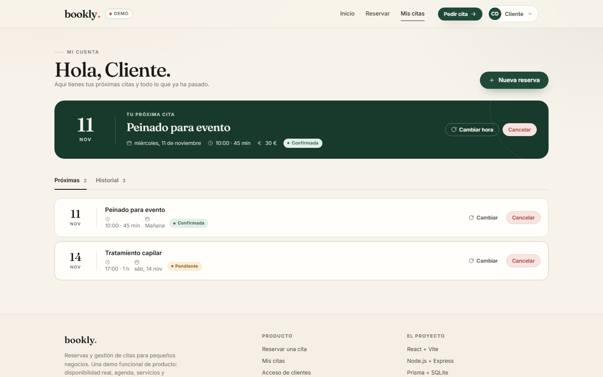

# BOOKLY · Reservas y gestión de citas

Aplicación **full-stack** de reservas y gestión de citas para pequeños negocios.
Pensada como pieza de portfolio: flujo de cliente completo, panel privado de
administración y una demo pública que funciona sin registro.

**Demo en vivo:** <https://dariorodrez.github.io/bookly/>

| Cuenta de demo | Email | Contraseña |
|---|---|---|
| Cliente | `cliente@bookly.com` | `cliente1234` |
| Administración | `admin@bookly.com` | `admin1234` |

La demo incluye botones de acceso rápido, datos de ejemplo y un enlace para
restablecerla. Los cambios se guardan solo en el navegador.

## Capturas

| Inicio | Elegir día y hora |
|---|---|
|  |  |

| Panel de administración | Mi cuenta |
|---|---|
|  |  |

## Stack

- **Frontend:** React 18 + Vite, CSS propio (design system), React Router 6, TanStack Query
- **Backend:** Node.js + Express (API REST)
- **Base de datos:** SQLite + Prisma ORM
- **Validación:** Zod compartido entre cliente y servidor (`shared/`)
- **Autenticación:** sesiones con cookie httpOnly (`express-session` + `connect-sqlite3`)
- **Pruebas:** Playwright (E2E)

## Funcionalidades

**Clientes**
- Registro e inicio de sesión (contraseñas hasheadas con bcrypt)
- Reserva en tres pasos: servicio → fecha y hora → confirmación
- Disponibilidad real calculada con la duración de cada servicio
- Consulta de sus citas, con historial
- Cancelación y **reprogramación** sin llamadas

**Administración**
- Resumen del negocio (citas de hoy, pendientes, clientes, ingresos del mes)
- Agenda por día con cambio de estado (confirmar, completar, no presentado, cancelar)
- CRUD de servicios, con desactivación segura si tienen citas
- Horario semanal por día, con intervalo de huecos configurable
- Bloqueos puntuales (día completo o franja horaria)
- Clientes con búsqueda, próxima cita y activación/desactivación
- Rutas y acciones protegidas por rol

**Transversal**
- Zona horaria del negocio `Europe/Madrid`: se guarda siempre en UTC y se muestra en local
- Anti-solapamiento: comprobación de disponibilidad + índice único parcial en base de datos
- Interfaz responsive (móvil y escritorio) y accesible (foco visible, etiquetas, ARIA)
- Validación en cliente y servidor, mensajes de error claros y avisos tipo toast

## Estructura

```
bookly/
├── client/          # React + Vite (UI real y motor de demo)
├── server/          # Express + Prisma + SQLite
├── shared/          # Esquemas Zod compartidos
├── tests/           # Playwright E2E
└── package.json     # Workspaces (npm)
```

## Cómo ejecutar

### Requisitos
- Node.js 20+
- npm 10+

### 1. Instalar dependencias
```bash
npm install
```

### 2. Configurar el backend
```bash
cd server
cp .env.example .env
# edita .env y pon un SESSION_SECRET aleatorio (>= 32 caracteres)
npx prisma migrate deploy
npm run db:seed
```

### 3. Arrancar en desarrollo
```bash
# backend en http://localhost:4000
npm run dev:server

# frontend en http://localhost:5173 (en otra terminal)
npm run dev:client
```

O ambos con un solo comando:
```bash
npm run dev
```

### Modo demo local
El cliente puede ejecutarse sin backend con la misma interfaz y un motor de
demo que replica la lógica del servidor (disponibilidad, solapamientos,
reprogramaciones, CRUD y estadísticas) sobre `localStorage`:

```bash
VITE_DEMO=true npm run dev:client
```

La build publicada en GitHub Pages usa `VITE_DEMO=true` y `VITE_BASE=/bookly/`.

## Pruebas

Con backend y frontend en marcha:

```bash
npx playwright test
```

Cubre el flujo completo de reserva y cancelación, el acceso y recorrido del
panel de administración, y el comportamiento responsive sin desbordes.

## API REST

| Método | Ruta | Auth | Descripción |
|---|---|---|---|
| POST | `/api/auth/register` | — | Registro |
| POST | `/api/auth/login` | — | Login |
| POST | `/api/auth/logout` | sesión | Logout |
| GET | `/api/auth/me` | sesión | Usuario actual |
| GET | `/api/services` | — | Servicios activos |
| GET | `/api/services/all` | ADMIN | Todos los servicios |
| GET | `/api/business-hours` | — | Horario público del negocio |
| GET | `/api/availability` | — | Huecos libres por servicio y fecha |
| GET | `/api/appointments/mine` | USER | Mis citas |
| POST | `/api/appointments` | USER | Crear cita |
| PATCH | `/api/appointments/:id/cancel` | USER/owner | Cancelar |
| PATCH | `/api/appointments/:id/reschedule` | USER/owner | Cambiar fecha y hora |
| GET | `/api/admin/users` | ADMIN | Clientes |
| GET | `/api/admin/appointments` | ADMIN | Citas |
| PATCH | `/api/admin/appointments/:id/status` | ADMIN | Cambiar estado |
| CRUD | `/api/admin/hours` | ADMIN | Horarios |
| CRUD | `/api/admin/blocks` | ADMIN | Bloqueos |
| GET | `/api/admin/stats` | ADMIN | Estadísticas |

## Seguridad implementada

- Contraseñas hasheadas (bcrypt, 12 rondas)
- Sesiones con cookie httpOnly, Secure en producción, SameSite=Lax
- Rate limiting en `/api/auth`: solo cuentan los intentos fallidos (30 / 15 min)
- Validación con Zod en cliente y servidor
- Control de roles por middleware (`requireRole`)
- Protección CSRF vía SameSite + validación de Origin
- Cabeceras seguras con Helmet y CORS restringido al origen del cliente
- Variables sensibles en `.env` (no versionado)
- Anti-solapamiento con transacción e índice único parcial:
  `(serviceId, startsAt)` para citas no canceladas

## Decisiones técnicas

- **Fechas:** el negocio trabaja en `Europe/Madrid`. La conversión de hora local
  a UTC resuelve el cambio de horario de verano con doble pasada de offset; la
  base de datos guarda instantes UTC y la UI formatea en la zona del negocio.
- **Doble comprobación de disponibilidad:** se valida antes de crear la cita y
  el índice único parcial actúa como última barrera ante condiciones de carrera.
- **Demo creíble:** el motor de demo no es un stub; aplica las mismas reglas de
  negocio que el servidor y persiste el estado en `localStorage`.
- **Diseño:** sistema propio de tokens y componentes CSS (ivory, verde bosque y
  terracota; Fraunces + Inter) en lugar de utilidades, para controlar tipografía,
  espaciado y estados.

## Licencia

ISC — proyecto de demostración. Los datos, imágenes y nombres son ficticios.
